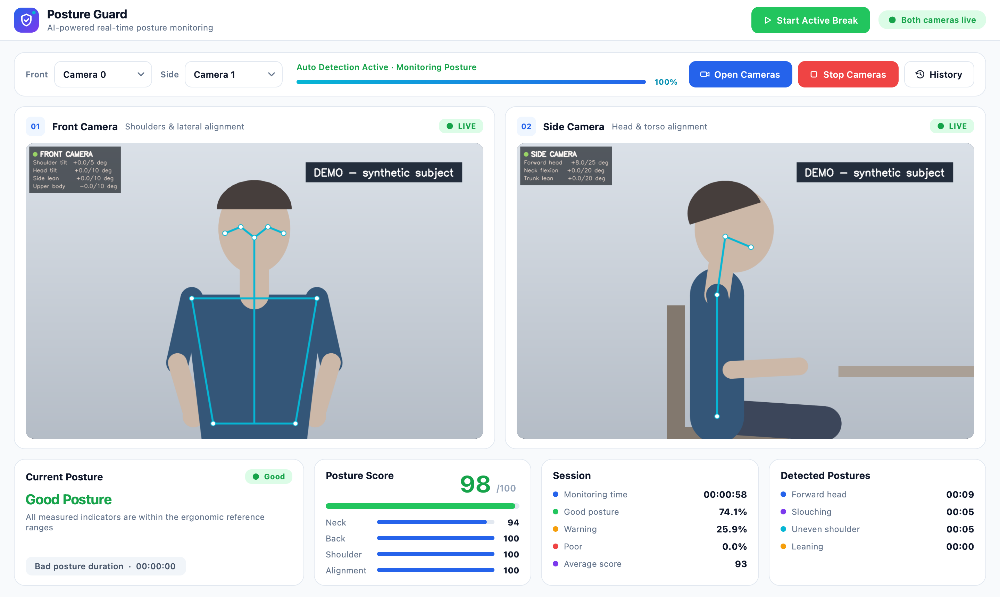
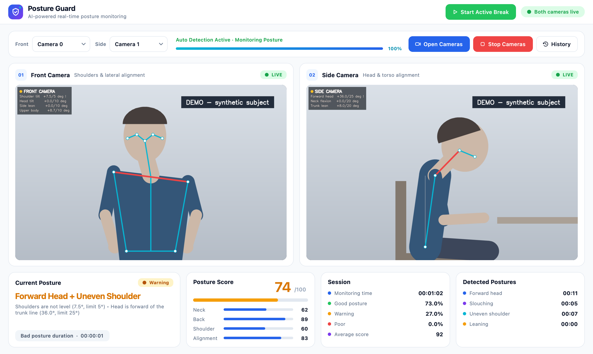
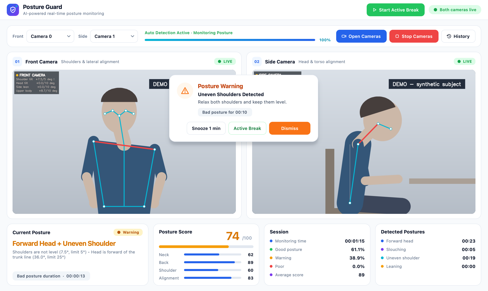
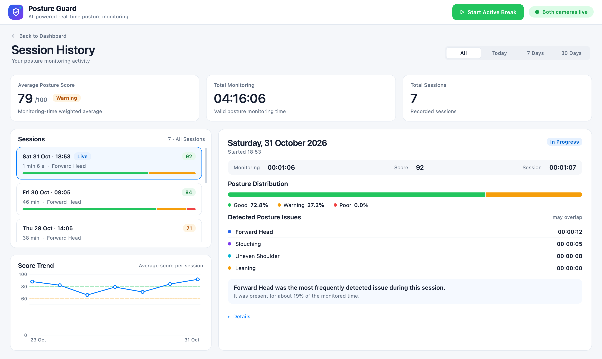
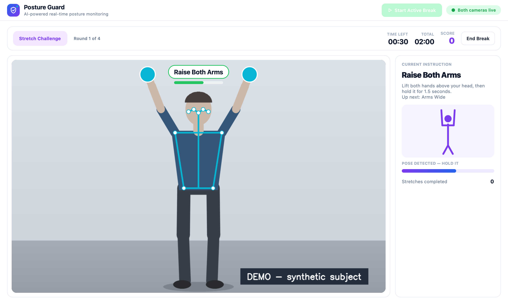
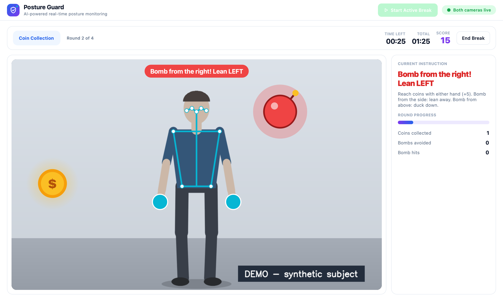

# Posture Guard — ระบบติดตามท่านั่งแบบเรียลไทม์ด้วยกล้อง 2 มุม

โปรเจกต์ Computer Vision: แอปเดสก์ท็อป (Python + PyQt6) ที่ใช้กล้อง 2 ตัว (ด้านหน้าและด้านข้าง)
ร่วมกับ MediaPipe Pose เพื่อตรวจท่านั่งระหว่างใช้คอมพิวเตอร์แบบเรียลไทม์

> เป็นเครื่องมือช่วยติดตามพฤติกรรมท่านั่ง ไม่ใช่เครื่องมือวินิจฉัยทางการแพทย์

## 1. ภาพรวมและวัตถุประสงค์
- ตรวจท่านั่งแบบเรียลไทม์จากกล้อง 2 มุม โดยเทียบกับเกณฑ์การยศาสตร์ (อ้างอิง OSHA / RULA) ไม่ต้อง calibrate
- แจ้งเตือนเมื่อผู้ใช้นั่งผิดท่าต่อเนื่อง และกระตุ้นให้ลุกขยับร่างกายด้วยเกมสั้น ๆ
- บันทึกสถิติการนั่งเพื่อให้ผู้ใช้เห็นแนวโน้มของตนเองในระยะยาว

## 2. ฟีเจอร์หลัก
- ตรวจท่านั่งอัตโนมัติ: Forward Head, Neck Flexion, Slouching, Uneven Shoulder, Leaning
- Posture Score 0–100 และสถานะ GOOD / WARNING / POOR พร้อม skeleton overlay บนภาพกล้อง
- ตรวจตำแหน่งกล้อง แจ้ง Insufficient Data และ Partial Monitoring (เมื่อใช้ได้เพียงกล้องเดียว)
- Popup เตือนเมื่อท่าผิดต่อเนื่อง 15 วินาที (Snooze / Active Break / Dismiss) และเตือนพักทุก 50 นาที
- Active Break: เกมยืดเหยียด (Stretch) และเกมเก็บเหรียญ (Coin) รวม 2 นาที ควบคุมด้วยท่าทางผ่านกล้องหน้า
- Session History: บันทึกอัตโนมัติ ดูรายงานรายครั้ง กรองตามช่วงวัน และกราฟแนวโน้มคะแนน
- เก็บข้อมูลไว้ในเครื่องเท่านั้น (SQLite) เป็นตัวเลขสถิติ ไม่บันทึกภาพหรือวิดีโอ

## 3. เทคโนโลยีที่ใช้
Python 3.11 · PyQt6 6.6 · OpenCV 4.11 · MediaPipe Pose 0.10.21 · NumPy 1.26 · SQLite (มากับ Python)

## 4. ภาพตัวอย่างการทำงาน
> **หมายเหตุ (Demo):** ภาพทั้งหมดเป็นหน้าจอจริงของแอป แต่ "ผู้ใช้" ในภาพกล้องเป็นหุ่นจำลอง (synthetic subject)
> ตำแหน่งข้อต่อ (landmarks) เป็นข้อมูลจำลองที่ส่งเข้าแทนผลจาก MediaPipe ส่วนการวิเคราะห์ท่า คะแนน การแจ้งเตือน
> เกม และหน้า History เป็นการทำงานจริงของแอป ข้อมูลใน History เป็นข้อมูลตัวอย่าง ไม่ใช่ข้อมูลของผู้ใช้จริง

| | |
|---|---|
|  **Dashboard** — ท่านั่งถูกต้อง |  **Dual Camera Monitoring** — ตรวจพบ Forward Head + Uneven Shoulder |
|  **Posture Warning** — popup หลังท่าผิด 15 วินาที |  **Session History** — สถิติและแนวโน้ม |
|  **Active Break: Stretch** |  **Active Break: Coin** |

## 5. การติดตั้งและใช้งาน
ต้องมี Python 3.11 (64-bit)

**Windows (PowerShell)** — เปิด PowerShell ในโฟลเดอร์โปรเจกต์:

```powershell
py -3.11 -m venv .venv
.venv\Scripts\Activate.ps1
python -m pip install --upgrade pip
pip install -r requirements.txt
python camera_test.py
python main.py
```

ถ้า PowerShell ไม่ยอมให้รัน `Activate.ps1` ให้ใช้ Command Prompt แล้วรัน `.venv\Scripts\activate.bat` แทน

**macOS (Terminal)**

```bash
python3.11 -m venv .venv
source .venv/bin/activate
python -m pip install --upgrade pip
pip install -r requirements.txt
python main.py
```

- `camera_test.py` ตรวจกล้องหมายเลข 0–5 และแสดงหมายเลขที่ใช้ได้
- ตรวจ logic หลักโดยไม่ต้องใช้กล้อง: `python self_test.py`

**ขั้นตอนใช้งาน**
1. เลือกหมายเลขกล้อง Front / Side แล้วกด **Open Cameras** ระบบจะเริ่มตรวจท่านั่งอัตโนมัติ
2. ดูสถานะ คะแนน และระยะเวลาท่าผิดบน Dashboard
3. กด **Start Active Break** เพื่อเล่นเกมขยับร่างกาย
4. กด **History** เพื่อดูประวัติ session (บันทึกให้อัตโนมัติ)
5. **Stop Cameras** = พัก session (กด Open Cameras เพื่อทำต่อ) / ปิดแอป = จบ session

## 6. Windows และการใช้กล้อง 2 ตัว
- โปรเจกต์นี้**พัฒนาบน macOS** และ**ทดสอบบน Windows 11 (Python 3.11.9) แล้ว**
  - ติดตั้ง `requirements.txt` ได้ รัน `python self_test.py` ผ่านครบ และเปิดแอปด้วย `python main.py` ได้
  - ตรวจท่านั่งจากกล้อง 2 ตัวพร้อมกันได้: Front = เว็บแคมของเครื่อง (Camera 0), Side = iPad, iPhone หรือ Android ผ่าน DroidCam (Camera 1)
  - บน Windows ต้องเปิดแอปด้วย `python main.py` เสมอ (ไม่ใช่ `python gui_modern.py`) เพราะ `main.py` โหลด MediaPipe
    ก่อน PyQt6 ถ้าโหลดสลับลำดับ MediaPipe จะขึ้น `DLL load failed while importing _framework_bindings`
- จากการตรวจซอร์สโค้ด ไม่พบส่วนที่ทำงานได้เฉพาะ macOS:
  - ส่วนที่เขียนสำหรับ macOS โดยเฉพาะจะถูกข้ามอัตโนมัติเมื่อรันบนระบบอื่น
  - ประวัติการใช้งานบน Windows ถูกเก็บที่ `%APPDATA%\Posture Guard\history.sqlite3`
  - กล้องถูกเปิดผ่าน OpenCV ตามหมายเลขกล้อง (0, 1, 2, …)
- ระบบต้องใช้กล้อง 2 ตัวที่คอมพิวเตอร์มองเห็นพร้อมกัน
  - **Front (กล้องหน้า):** วางตรงหน้าผู้ใช้ ให้เห็นศีรษะ ไหล่ และสะโพก
  - **Side (กล้องข้าง):** วางด้านข้างประมาณ 90° ให้เห็นหู ไหล่ และสะโพกฝั่งเดียวกัน
- ทางเลือกที่แนะนำบน Windows: เว็บแคมของโน้ตบุ๊ก (หรือ USB webcam) + USB webcam อีก 1 ตัว
- ปิดการซูมหรือติดตามใบหน้าอัตโนมัติของกล้อง (ถ้ามี) และจัดแสงให้เห็นร่างกายชัดเจน

## 7. Windows + iPhone / iPad: ข้อจำกัด
- Windows ไม่มีฟีเจอร์ใช้ iPhone / iPad เป็นกล้องในตัว (Continuity Camera มีเฉพาะ Mac)
- ต้องติดตั้งแอปเว็บแคมของบุคคลที่สามทั้งบนอุปกรณ์ Apple และ Windows เพื่อให้ปรากฏเป็นกล้องบน Windows
  - ตรวจก่อนว่าแอป **Camera** ของ Windows มองเห็นกล้องนั้น
  - จากนั้นรัน `python camera_test.py` ถ้าสคริปต์ไม่พบกล้อง แอปนี้จะใช้กล้องนั้นไม่ได้
- **ทดสอบแล้ว:** iPad และ iPhone ผ่านแอป DroidCam (ติดตั้งแอปบนอุปกรณ์ และ DroidCam Client บน Windows) ใช้เป็นกล้อง Side ได้
  - ถ้าภาพตะแคง 90° ให้หมุนภาพใน DroidCam Client หรือวางอุปกรณ์ในแนวที่ภาพตั้งตรง เพราะ MediaPipe จับท่าทางจากภาพที่ตะแคงไม่ได้
  - ถ้า DroidCam ยังไม่เชื่อมต่อกับอุปกรณ์ Windows จะยังเห็นกล้องนั้นและแอปแสดง "Both cameras live"
    แต่ภาพเป็นหน้าจอ "Start DroidCam" และกล้องข้างจะขึ้น "no person detected" ให้เชื่อมต่อก่อนเปิดกล้องในแอป
- **ทดสอบแล้ว:** Android (Samsung ผ่าน DroidCam) ใช้เป็นกล้อง Side ได้เช่นกัน
  - ถ้าวางเครื่องเอียงหรือภาพหมุน แอปจะแจ้ง "Side camera looks rotated — mount it upright" และทำงานแบบ
    Partial Monitoring (ใช้เฉพาะกล้องหน้า) เมื่อตั้งเครื่องให้ตั้งตรงแล้ว จะกลับมาตรวจท่านั่งจากกล้องทั้งสองตัวตามปกติ

## 8. ประโยชน์ของโปรเจกต์
- ช่วยให้ผู้ใช้คอมพิวเตอร์รู้ตัวเมื่อนั่งผิดท่า ก่อนจะกลายเป็นความเคยชิน
- กล้องด้านข้างช่วยวัดสิ่งที่กล้องหน้าวัดได้ยาก เช่น ศีรษะยื่นไปข้างหน้าและการนั่งหลังค่อม
- กระตุ้นการพักและขยับร่างกายด้วยเกมสั้น ๆ แทนการเตือนด้วยข้อความอย่างเดียว
- ใช้อุปกรณ์ทั่วไป (เว็บแคม) และประมวลผลในเครื่อง ไม่ส่งภาพออกไปภายนอก

## 9. ข้อจำกัดที่ทราบ
- บน Windows ทดสอบกับ iPad, iPhone และ Android (DroidCam) ยังไม่ได้ทดสอบ
  Active Break กับหน้า History ด้วยกล้องจริงบน Windows
- การทดสอบส่วนใหญ่เป็นการทดสอบอัตโนมัติด้วยข้อมูลจำลองบน macOS การทดสอบกับผู้ใช้จริงยังจำกัด
- วิเคราะห์จากภาพ 2 มิติ (ไม่ใช่ 3D) ความแม่นยำขึ้นกับตำแหน่งกล้อง แสง และการมองเห็นร่างกาย
- เกณฑ์ทั้งหมดเป็นค่าทดลองที่อิงแนวปฏิบัติ ยังไม่ผ่านการตรวจสอบทางคลินิก
- ประมวลผลท่าทางจาก 2 กล้องพร้อมกัน อาจทำงานช้าบนเครื่องสเปกต่ำ
